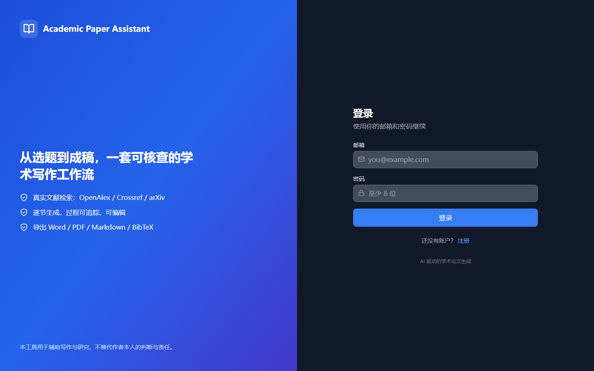
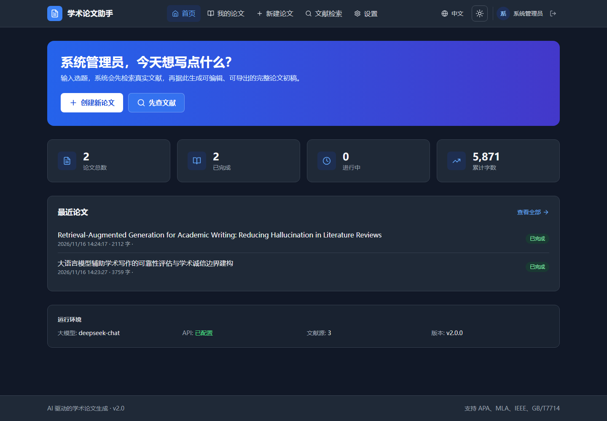
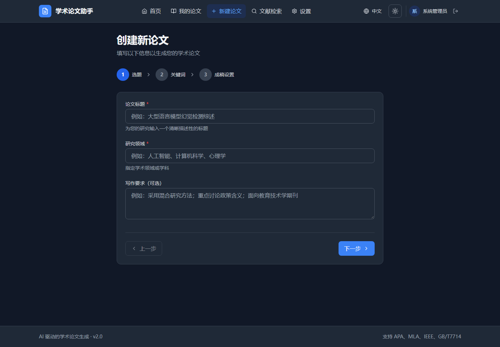
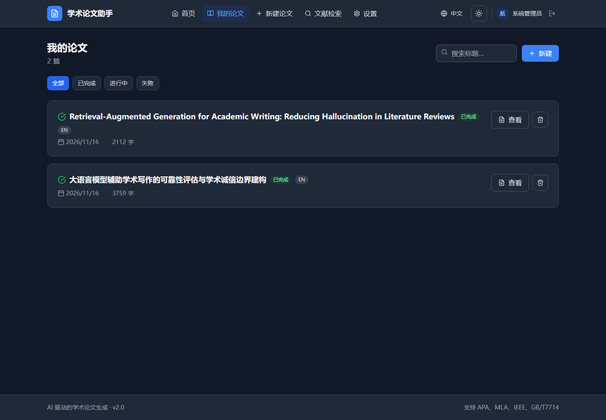
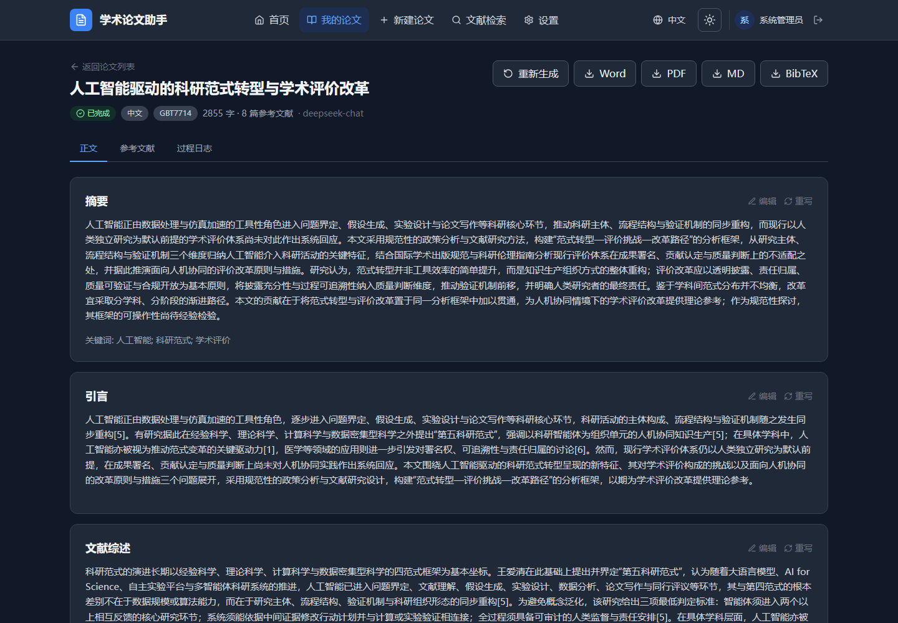
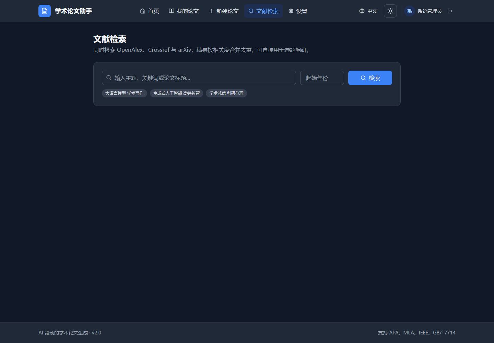
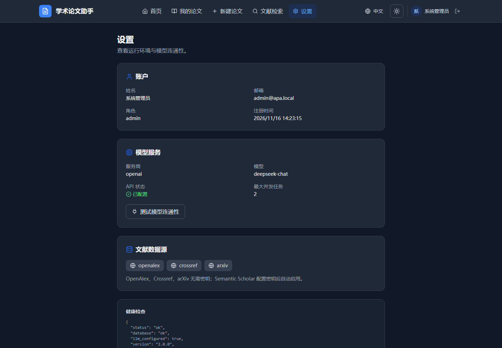

# 07 · 前端设计

| 项目 | 内容 |
|---|---|
| 文档编号 | APA-DOC-07 |
| 版本 | V2.0 |
| 设计定稿 | 2026-06 |
| 最近校订 | 2026-11-16 |
| 技术栈 | React 18、TypeScript 5、Vite 5、Tailwind CSS 3、react-router 6、lucide-react |

## 7.1 页面结构

```
/login                    登录 / 注册（左右分栏，左侧产品说明）
└── 受保护区域（Layout）
    ├── /                 工作台：统计卡片、最近论文、运行环境
    ├── /papers           论文列表：状态筛选、标题搜索、进度条
    ├── /create           三步向导：选题 → 关键词 → 成稿设置
    ├── /papers/:id       论文查看器：正文 / 参考文献 / 过程日志
    ├── /literature       文献检索：多源结果、年份过滤
    └── /settings         设置：账户、模型连通性、数据源、健康检查
```

未登录访问任意页面会被重定向到 `/login`；登录后回到原路径。

## 7.2 状态管理

不引入 Redux，按作用域分三层：

| 状态 | 存放 | 生命周期 |
|---|---|---|
| 登录用户 / token | `AuthContext` + `localStorage` | 全局、跨刷新 |
| 主题（明/暗） | `ThemeContext` + `localStorage` | 全局、跨刷新 |
| 界面语言（中/英） | `LanguageContext` + `localStorage` | 全局、跨刷新 |
| 论文、进度、日志 | 页面内 `useState` | 单页 |

理由：页面之间没有共享的业务状态（每个页面自行拉取），引入全局 store 只会增加样板代码。

## 7.3 认证流程

```
Login 页 ──login()──► AuthContext ──POST /api/auth/login──► 存 token + user
                              │
页面刷新 ──► AuthContext 挂载 ──GET /api/auth/me──► 恢复用户
                              │ 401
                              └─► 清除 token，跳转 /login
```

axios 响应拦截器统一处理 401：清除 token 并派发 `apa:unauthorized` 事件，`AuthContext` 监听后置空用户，`Protected` 组件随即重定向。这样任何接口的过期都能触发同一套登出逻辑。

## 7.4 生成过程的实时呈现

`streamPaper()` 用 `fetch` 读取 `text/event-stream`，手写帧解析：

```ts
buffer += decoder.decode(value, { stream: true });
const blocks = buffer.split('\n\n');
buffer = blocks.pop() || '';
for (const block of blocks) { 解析 event: / data: }
```

选择 `fetch` 而非 `EventSource` 的原因：`EventSource` 不能自定义请求头，无法携带 Bearer token。

界面表现：

- 顶部进度条 + 阶段文案（检索文献 / 拟定提纲 / 分节写作…），数据来自 `paper.progress` 与 `paper.stage`；
- 「过程日志」页签按时间倒序展示事件，颜色区分 info/warning/error；
- 每 4 秒额外轮询一次详情接口作为兜底，防止代理缓冲导致 SSE 延迟；
- 完成后自动刷新论文详情，按钮区从「取消」切换为「重新生成 + 四种导出」。

## 7.5 论文查看器交互

| 操作 | 交互 | 接口 |
|---|---|---|
| 编辑章节 | 点击「编辑」就地展开 textarea，保存后局部更新 | `PUT .../sections/{key}` |
| 重写章节 | 弹窗填写补充要求，确认后显示行内 loading | `POST .../regenerate` |
| 取消 / 重试 | 顶部按钮，状态互斥 | `POST .../cancel`、`.../retry` |
| 导出 | 四个按钮，各自独立 loading，失败弹出错误条 | `GET .../export/{fmt}` |

编辑使用的是**受控 textarea + 单独保存**，而不是失焦自动保存——避免误触导致内容丢失。

## 7.6 视觉与可用性

- **主题**：`class` 策略的深色模式，跟随系统偏好，可手动切换并记忆；
- **语言**：中英文切换，业务文案在 `i18n/translations.ts`，页内新增文案采用内联双语；
- **响应式**：导航在窄屏折叠为图标；表单与卡片使用 `grid` 自适应；
- **空状态**：列表、检索、日志均有插画式空状态与操作引导；
- **错误呈现**：接口错误统一转为可读中文条幅，不暴露堆栈。

## 7.7 页面截图

| 页面 | 截图 |
|---|---|
| 登录 |  |
| 工作台 |  |
| 新建论文 |  |
| 论文列表 |  |
| 论文查看器 |  |
| 文献检索 |  |
| 设置 |  |

截图取自实际运行的系统（论文查看器一张取自线上部署实例，其余为本地实例）。

## 7.8 构建与产物

```bash
cd frontend
npm ci
npm run build     # tsc 类型检查 + vite build
```

产物：`dist/index.html` + `dist/assets/index-[hash].{js,css}`，gzip 后约 144 KB。后端以通配路由回退到 `index.html`，因此 `/papers/xxx` 这类深链接可直接刷新。

## 7.9 前端代码组织

| 文件 | 行数 | 职责 |
|---|---:|---|
| `App.tsx` | 143 | 路由、布局、导航、登录守卫 |
| `pages/Login.tsx` | 152 | 登录注册 |
| `pages/Dashboard.tsx` | 194 | 工作台 |
| `pages/CreatePaper.tsx` | 329 | 三步创建向导 |
| `pages/PaperList.tsx` | 201 | 列表与筛选 |
| `pages/PaperViewer.tsx` | 478 | 正文、编辑、重写、导出、日志 |
| `pages/Literature.tsx` | 146 | 文献检索 |
| `pages/Settings.tsx` | 145 | 设置 |
| `services/api.ts` | 211 | HTTP 封装、SSE、下载 |
| `contexts/AuthContext.tsx` | 77 | 认证状态 |
| `types/index.ts` | 147 | 类型定义 |
